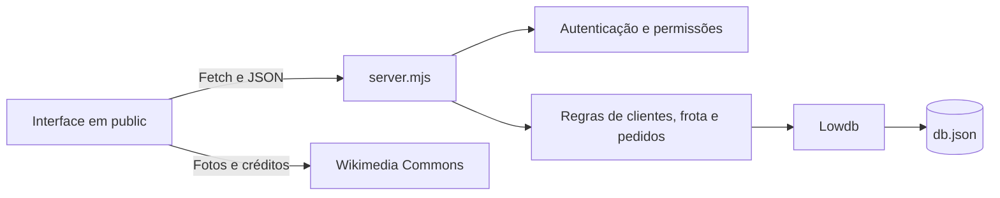
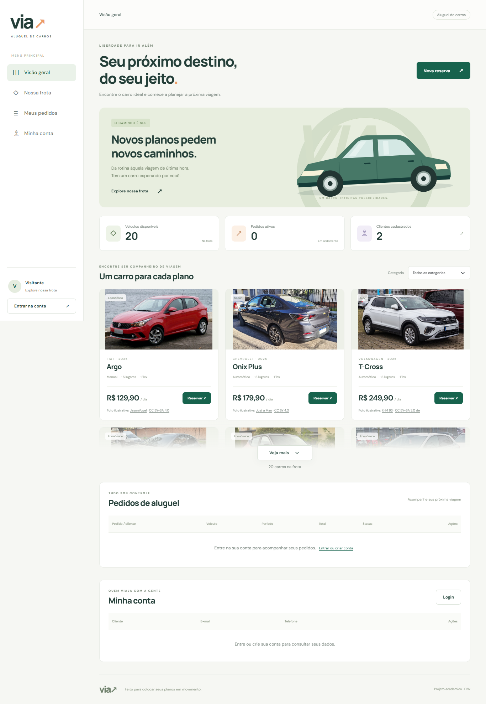
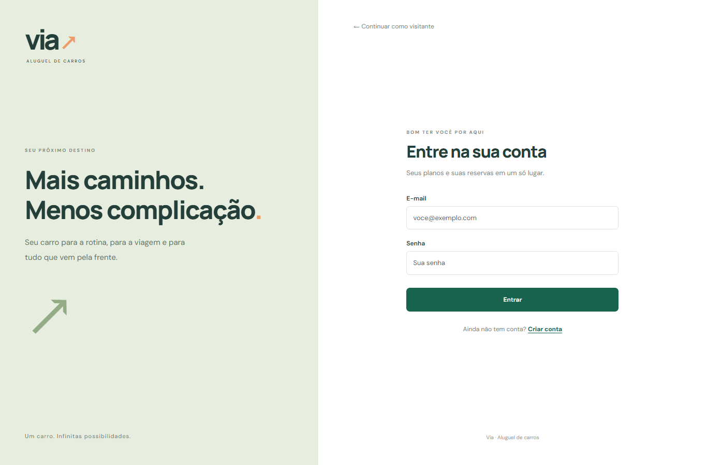
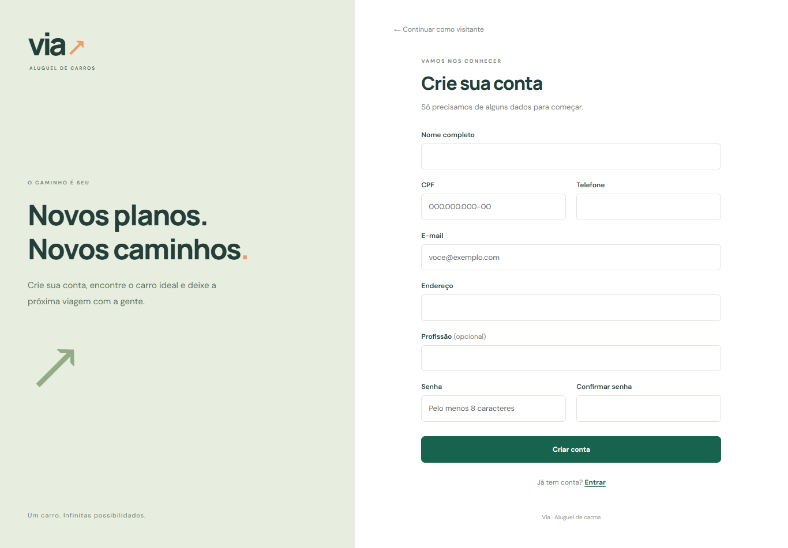
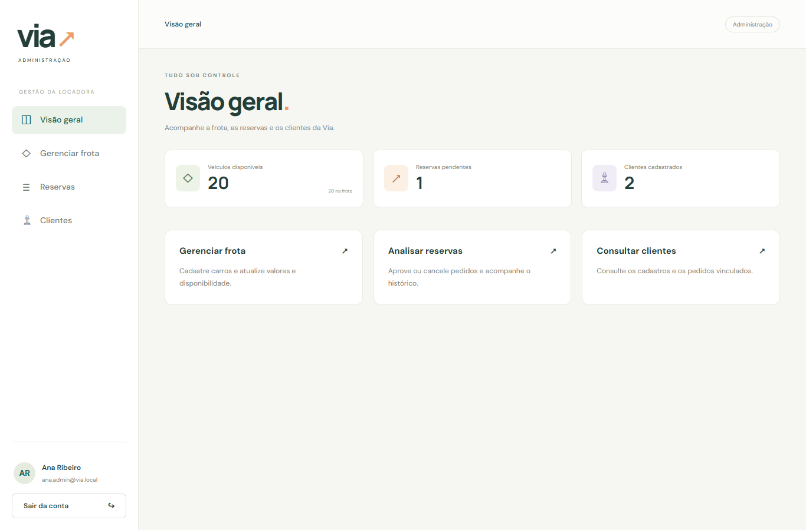

# via — Aluguel de Automóveis

<p align="center">
  
</p>

Sistema web para consultar veículos e gerenciar pedidos de aluguel. Clientes podem criar uma conta, reservar um carro e acompanhar seus pedidos; administradores gerenciam a frota e analisam as reservas.

| Contexto acadêmico | Informação |
|---|---|
| Curso | Ciência da Computação |
| Disciplina | Desenvolvimento de Interfaces Web — DIW |
| Atividade | Laboratório 02 — Sistema de Aluguel de Carros |
| Docente do enunciado | João Paulo Carneiro Aramuni |

## 🚧 Status do projeto

**Protótipo acadêmico em desenvolvimento, com execução local.** A base de demonstração contém 20 veículos, 2 clientes, 3 pedidos e 3 administradores.

O cadastro de novos clientes, o fluxo de reservas e o painel administrativo estão implementados. Há diferenças em relação ao escopo completo do enunciado e uma pendência no login dos clientes pré-cadastrados, descritas nas seções de requisitos e testes.

## 📚 Índice

- [Links úteis](#links-uteis)
- [Sobre o projeto](#sobre-o-projeto)
- [Funcionalidades principais](#funcionalidades)
- [Relação com o enunciado](#requisitos)
- [Tecnologias utilizadas](#tecnologias)
- [Arquitetura e modelagem](#arquitetura)
- [Instalação e execução](#execucao)
- [Contas de demonstração](#contas)
- [API](#api)
- [Deploy](#deploy)
- [Estrutura de pastas](#estrutura)
- [Demonstração](#demonstracao)
- [Testes](#testes)
- [Documentações utilizadas](#documentacoes)
- [Autores](#autores)
- [Contribuição](#contribuicao)
- [Agradecimentos](#agradecimentos)
- [Licença](#licenca)

<a id="links-uteis"></a>
## 🔗 Links úteis

- [Enunciado do Laboratório 02](documents/DIW_-_LABORATO%CC%81RIO_02_-_Sistema_de_Aluguel_de_Carros.pdf).
- [Template utilizado para a documentação](documents/template_README.md).
- [Casos de uso, histórias de usuário e diagramas](documents/modelagem.md).
- [Instruções da administração](documents/admin/README.md).
- [Credenciais de demonstração comentadas](documents/admin/credenciais.example.js).
- [Aplicação local](http://localhost:3000), disponível após iniciar o servidor.

<a id="sobre-o-projeto"></a>
## 📝 Sobre o projeto

A via foi desenvolvida para praticar construção de interfaces web, manipulação do DOM, comunicação com APIs e persistência de dados em um sistema de aluguel de automóveis.

O projeto concentra a consulta da frota, os dados dos clientes e o acompanhamento das reservas em uma interface responsiva. O visitante pode conhecer os carros; ao iniciar uma reserva, precisa entrar em uma conta ou se cadastrar. O administrador utiliza o mesmo formulário de login e é redirecionado automaticamente ao painel de gestão.

O protótipo utiliza dados fictícios e representa uma parte do domínio descrito no laboratório. A avaliação financeira de empresas e bancos e a formalização de contratos ainda não foram implementadas.

<a id="funcionalidades"></a>
## ✨ Funcionalidades principais

### Visitante e cliente

- Consulta de 20 carros nas categorias Econômico, Sedan e SUV.
- Prévia da primeira linha da frota, com fade e botões **Veja mais** e **Ver menos**.
- Fotos consultadas na API do Wikimedia Commons, com autor, licença e ilustração alternativa em caso de falha.
- Cadastro com nome, CPF, e-mail, telefone, endereço, profissão e senha.
- Login com e-mail e senha e retorno ao carro selecionado antes da autenticação.
- Criação, consulta, alteração e cancelamento dos próprios pedidos.
- Cálculo do total pela quantidade de diárias e pelo preço do veículo.
- Consulta dos estados **Pendente**, **Aprovado** e **Cancelado**.
- Edição dos dados pessoais e exclusão da conta quando não existem pedidos vinculados.
- Menu lateral com dados do usuário na parte inferior e adaptação para celular.

### Administrador

- Painel com totais de veículos disponíveis, reservas pendentes e clientes cadastrados.
- Cadastro, edição e exclusão de veículos, respeitando os vínculos com pedidos.
- Alteração de diária, dados do automóvel e disponibilidade para novas reservas.
- Consulta de todos os pedidos, filtro por status, aprovação e cancelamento.
- Consulta e exclusão de clientes sem reservas vinculadas.
- Três contas administrativas predefinidas; o cadastro público cria exclusivamente clientes.
- Usuário exemplo: email: ana.admin@via.local - senha: ViaAdmin01!

### Regras aplicadas pelo servidor

- CPF com 11 dígitos e verificação de duplicidade de CPF e e-mail. A validação não calcula os dígitos verificadores do CPF.
- Devolução posterior à retirada e restrição à criação de reservas com retirada no passado.
- Recusa de reservas sobrepostas para o mesmo veículo, considerando pedidos não cancelados.
- Recálculo do preço no servidor, sem confiar nos valores enviados pelo navegador.
- Permissões por perfil e acesso do cliente somente aos seus dados e pedidos.
- Preservação de clientes e veículos associados ao histórico de reservas.

<a id="requisitos"></a>
## 📋 Relação com o enunciado

O PDF apresenta um sistema mais amplo que o protótipo atual. A tabela registra o que foi implementado e as adaptações realizadas.

| Item do laboratório | Situação no projeto |
|---|---|
| HTML5, CSS3, JavaScript, Bootstrap 5 e consumo via Fetch | Implementado. |
| API e persistência com JSON Server | Adaptado: a execução atual usa `server.mjs` em Node.js e Lowdb sobre `db.json`. O JSON Server permanece como dependência de desenvolvimento, mas não é iniciado por `npm start`. |
| Utilização após cadastro prévio | Cadastro e login exigidos para reservar e gerenciar dados; a consulta da frota é liberada a visitantes. |
| CRUD de cliente | Cadastro público, consulta, edição e exclusão condicionada à ausência de pedidos. |
| Introduzir, modificar, consultar e cancelar pedidos | Implementado para os pedidos do próprio cliente. |
| Avaliação de pedidos por agentes | Representação parcial no administrador, que aprova ou cancela reservas; não há perfis separados de empresas e bancos nem análise financeira. |
| Dados de identificação e profissão | Nome, CPF, endereço e profissão implementados. O RG foi removido nesta versão por definição de escopo. |
| Até três empregadores e respectivos rendimentos | Ainda não implementado. |
| Matrícula, ano, marca, modelo e placa do automóvel | Implementado, com campos adicionais de categoria, câmbio, combustível, diária e disponibilidade. |
| Gestão de contratos e propriedade do veículo por cliente, empresa ou banco | Ainda não implementado. |
| Contrato de crédito associado ao aluguel | Ainda não implementado. |
| Casos de uso, histórias, classes, pacotes e componentes | Documentados em [modelagem.md](documents/modelagem.md), conforme a implementação atual. |
| Histórico de revisão dos modelos e atualização do repositório | Esta documentação registra a versão atual; o histórico anterior e a publicação no GitHub ficam a cargo do responsável pelo projeto. |

A adoção do servidor próprio permitiu aplicar autenticação e permissões na API. Essa alteração em relação à stack solicitada no PDF deve ser considerada na apresentação e na validação acadêmica da atividade.

<a id="tecnologias"></a>
## 🛠 Tecnologias utilizadas

| Camada | Tecnologias e finalidade |
|---|---|
| Estrutura e interação | HTML5, JavaScript, DOM, formulários, `dialog` e Fetch API. |
| Interface | CSS3, Grid, Flexbox, media queries e Bootstrap **5.3.3** via CDN. |
| Servidor | Node.js, módulos ES e API HTTP nativa em `server.mjs`. |
| Persistência | Lowdb **7.0.1**, adaptador `JSONFile` e arquivo `db.json`. |
| Autenticação | `node:crypto`, PBKDF2 com SHA-256, salt individual e tokens opacos de sessão. |
| Fotos | MediaWiki Action API, módulo `Imageinfo`, no Wikimedia Commons. |
| Testes | Runner nativo `node:test`, `node:assert/strict` e requisições HTTP com `fetch`. |
| Desenvolvimento | npm, VS Code e configuração opcional do Live Server para `public/`. |

O projeto não exige uma etapa de build: os arquivos de `public/` são servidos diretamente. O JSON Server **1.0.0-beta.15** consta nas dependências de desenvolvimento como parte da estrutura anterior do protótipo.

<a id="arquitetura"></a>
## 🏗 Arquitetura e modelagem

A aplicação tem uma interface estática com renderização dinâmica por JavaScript, uma API HTTP local e persistência em arquivo JSON. Os módulos de login, cliente e administrador compartilham a comunicação com a API por meio de `public/login/auth.js`.



`server.mjs` entrega os arquivos públicos, valida as operações e controla o acesso aos dados. As coleções de administradores, o banco completo e os arquivos de credenciais não são disponibilizados como arquivos estáticos.

### Sessão e autenticação

1. O formulário envia e-mail e senha ao servidor.
2. O servidor verifica o hash da senha e identifica o perfil da conta.
3. Uma conta de cliente retorna à página pública; uma conta administrativa segue para o painel.
4. O token acompanha as chamadas autenticadas no cabeçalho `Authorization: Bearer`.

A transferência entre as páginas utiliza `sessionStorage` uma única vez. Depois, o token permanece em memória. Recarregar a página volta ao modo visitante e exige novo login. As sessões têm duração máxima de 30 minutos e também são perdidas quando o servidor é reiniciado.

### Modelo de dados

| Coleção | Conteúdo |
|---|---|
| `veiculos` | Identificação do carro, especificações, diária, disponibilidade e referência da imagem. |
| `clientes` | Identificação e contato do cliente; contas criadas pelo cadastro recebem hash e salt da senha. |
| `pedidos` | Cliente, veículo, datas, diária, total, status e data de criação. |
| `administradores` | Contas administrativas predefinidas e dados de autenticação. |

Os relacionamentos são registrados por `clienteId` e `veiculoId`. Os diagramas de classes, casos de uso, pacotes e componentes, acompanhados das histórias de usuário, estão em [documents/modelagem.md](documents/modelagem.md).

<a id="execucao"></a>
## 🔧 Instalação e execução

### Pré-requisitos

- Node.js **22.12 ou superior**, compatível com as dependências presentes no projeto.
- npm.
- Navegador atualizado.
- Conexão com a internet para baixar dependências, Bootstrap, fontes e fotos externas.

Ambiente utilizado nesta verificação: **Node.js 24.21.0** e **npm 11.19.0**.

### Instalar as dependências

Na pasta que contém `package.json`:

```bash
npm install
```

### Executar

```bash
npm start
```

Abra **http://localhost:3000**. A mensagem do terminal será semelhante a:

```text
Via disponível em http://localhost:3000
```

O mesmo processo entrega a interface e a API. Para encerrar, pressione **Ctrl+C** no terminal do servidor. Se a porta 3000 estiver ocupada, encerre a instância anterior antes de iniciar outra.

Use `npm start` para executar esta versão. O comando antigo `json-server db.json --static .` não implementa as rotas de login e as verificações de permissão do servidor atual.

### Banco de dados

O arquivo `db.json` já acompanha o projeto com a massa de demonstração. Não é necessário criar tabelas ou executar migrações. As alterações realizadas pela aplicação são persistidas nesse arquivo.

O servidor carrega o banco na inicialização. Se você editar `db.json` manualmente, reinicie o processo para carregar os novos dados.

### Variáveis de ambiente

| Variável | Padrão | Finalidade |
|---|---|---|
| `PORT` | `3000` | Porta HTTP do servidor. |
| `HOST` | `localhost` | Endereço em que o servidor escuta. |
| `DB_FILE` | `db.json` na raiz | Arquivo de persistência; os testes usam uma cópia temporária. |

Nenhum arquivo `.env` é necessário para a configuração padrão. O código lê essas variáveis do ambiente do processo. A URL da API no navegador está definida em `public/login/auth.js` como `http://localhost:3000`; ao alterar a porta do backend, esse endereço também precisa ser ajustado.

O Live Server está configurado para abrir a pasta `public/`, mas ainda depende do backend iniciado com `npm start` para login e operações de dados.

<a id="contas"></a>
## 🔐 Contas de demonstração

Entre pelo formulário comum de login. O sistema reconhece o administrador e o direciona automaticamente ao painel, sem um link administrativo no menu público.

| Perfil | E-mail | Senha de demonstração |
|---|---|---|
| Administradora | `ana.admin@via.local` | `ViaAdmin01!` |
| Administrador | `bruno.admin@via.local` | `ViaAdmin02!` |
| Administradora | `carla.admin@via.local` | `ViaAdmin03!` |

Para testar como cliente, escolha **Criar conta** na página de login. O cadastro gera uma conta com senha válida para autenticação.

**Pendência da massa atual:** Marina e Lucas estão cadastrados, mas seus registros no `db.json` não possuem `senhaHash` e `senhaSalt`. A anotação `_senha` não substitui esses campos e não é utilizada pelo login. Por isso, as senhas de cliente anotadas no arquivo de credenciais não autenticam essas duas contas no estado atual do banco.

As anotações locais de senha são destinadas à demonstração acadêmica e não são retornadas nos dados de perfil da API. JSON não aceita comentários `//`; campos como `_senha` são dados adicionais, não comentários da linguagem.

<a id="api"></a>
## 🌐 API

Endereço padrão: `http://localhost:3000`. As requisições com corpo utilizam `Content-Type: application/json`.

| Método | Rota | Finalidade e acesso |
|---|---|---|
| `POST` | `/auth/register` | Cadastro público de cliente. |
| `POST` | `/auth/login` | Entrada de cliente ou administrador. |
| `GET` | `/auth/me` | Perfil da sessão autenticada. |
| `POST` | `/auth/logout` | Encerramento da sessão autenticada. |
| `GET` | `/resumo` | Quantidade de clientes, sem dados pessoais. |
| `GET` | `/veiculos` e `/veiculos/:id` | Consulta pública da frota. |
| `POST` | `/veiculos` | Cadastro de veículo, exclusivo de administrador. |
| `PATCH`, `DELETE` | `/veiculos/:id` | Alteração ou exclusão de veículo, exclusiva de administrador. |
| `GET` | `/clientes` e `/clientes/:id` | Cliente consulta seu cadastro; administrador consulta todos. |
| `PATCH`, `DELETE` | `/clientes/:id` | Edição ou exclusão autorizada da conta, conforme seus vínculos. |
| `GET` | `/pedidos` e `/pedidos/:id` | Cliente consulta seus pedidos; administrador consulta todos. |
| `POST` | `/pedidos` | Criação de reserva autenticada para um cliente válido. |
| `PATCH` | `/pedidos/:id` | Alteração/cancelamento pelo titular e análise pelo administrador. |

As listagens de clientes e pedidos retornam listas vazias a visitantes. Não existe uma rota pública para cadastrar administradores.

Exemplo de consulta da frota no PowerShell ou em um terminal com cURL:

```bash
curl.exe http://localhost:3000/veiculos
```

No Linux/macOS, utilize `curl` no lugar de `curl.exe`.

<a id="deploy"></a>
## 🚀 Deploy

A execução documentada é local; não há endereço de demonstração publicado informado para esta versão. A publicação e os links do GitHub serão definidos pelo responsável pelo projeto.

Uma hospedagem futura precisa executar o servidor Node.js e persistir `db.json`. Também deve ajustar a URL da API e a configuração de origens, que atualmente aceita chamadas de endereços locais. Servir somente a pasta `public/` não disponibiliza as funcionalidades de autenticação e persistência.

<a id="estrutura"></a>
## 📂 Estrutura de pastas

```text
diw/
├── .vscode/
│   └── settings.json              # Raiz do Live Server em public/
├── documents/
│   ├── DIW_...Carros.pdf          # Enunciado original do laboratório
│   ├── template_README.md         # Template de documentação fornecido
│   ├── modelagem.md               # Casos de uso, histórias e diagramas
│   ├── images/                    # Marca e capturas usadas neste README
│   └── admin/
│       ├── README.md              # Instruções da administração
│       └── credenciais.example.js # Credenciais comentadas de demonstração
├── public/
│   ├── index.html                 # Página pública
│   ├── style.css                  # Estilos e layout responsivo
│   ├── script.js                  # Frota, conta e reservas do cliente
│   ├── images/                    # Diretório reservado a imagens locais
│   ├── login/
│   │   ├── index.html             # Login
│   │   ├── cadastro.html          # Cadastro de cliente
│   │   ├── auth.js                # Comunicação com API e sessão
│   │   ├── login.js               # Eventos dos formulários
│   │   └── login.css              # Estilos de autenticação
│   └── admin/
│       ├── index.html             # Painel administrativo
│       ├── admin.js               # Gestão de carros, clientes e pedidos
│       └── admin.css              # Estilos administrativos
├── tests/
│   └── admin.test.mjs             # Testes HTTP de integração e permissões
├── db.json                        # Dados persistidos
├── server.mjs                     # Servidor HTTP e regras de acesso
├── package.json                   # Scripts e dependências
├── package-lock.json              # Versões das dependências
└── README.md
```

<a id="demonstracao"></a>
## 🎥 Demonstração

Capturas da implementação atual, produzidas com uma cópia temporária do banco.

| Página inicial e prévia da frota | Login |
|---|---|
|  |  |
| **Cadastro de cliente** | **Painel administrativo** |
|  |  |

### Roteiro de uso

1. Abra a página inicial e use **Veja mais** para explorar a frota; **Ver menos** recolhe a listagem.
2. Clique em **Reservar**. Como visitante, você será direcionado ao login.
3. Crie uma conta de cliente. Ao retornar, o carro escolhido permanece selecionado.
4. Escolha retirada e devolução e confira o total antes de salvar.
5. Consulte **Meus pedidos** para editar, cancelar ou acompanhar o status.
6. Para analisar o pedido, saia e entre com uma conta administrativa; utilize a seção **Reservas** do painel.

<a id="testes"></a>
## 🧪 Testes

Execute:

```bash
npm test
```

A suíte em `tests/admin.test.mjs` usa `node:test` e inicia o servidor em uma porta livre, com uma cópia temporária de `db.json`. Os testes não modificam o banco principal.

São verificados: entrega dos arquivos de `public/`, redirecionamentos, proteção de arquivos internos, autenticação, restrição ao cadastro administrativo, isolamento entre clientes, cálculo e conflitos de reservas, operações administrativas e encerramento de sessão.

### Resultado desta revisão

```text
tests 10
pass 8
fail 2
```

A falha funcional está no cenário de login dos clientes de demonstração, que recebe HTTP `401` em vez de `200` porque Marina e Lucas estão sem hash e salt no banco atual. O runner também marca o grupo que contém esse cenário como falho, totalizando duas falhas no relatório. Os demais cenários passaram.

Há ainda um pedido da massa de demonstração cujo `clienteId` não corresponde a um cliente existente. A interface o apresenta como **Cliente indisponível**. Esses pontos precisam ser regularizados para uma massa de testes totalmente consistente.

As capturas de tela são demonstrações visuais. Não há script `test:e2e` configurado em `package.json`.

<a id="documentacoes"></a>
## 🔗 Documentações utilizadas

- [Enunciado do Laboratório 02](documents/DIW_-_LABORATO%CC%81RIO_02_-_Sistema_de_Aluguel_de_Carros.pdf) e [template de README](documents/template_README.md), fornecidos para a atividade.
- [Bootstrap 5.3 — introdução](https://getbootstrap.com/docs/5.3/getting-started/introduction/), referência para os componentes e estilos da interface.
- [MDN — utilização da Fetch API](https://developer.mozilla.org/pt-BR/docs/Web/API/Fetch_API/Using_Fetch), referência para comunicação HTTP no navegador.
- [Node.js — módulo HTTP](https://nodejs.org/api/http.html), referência do servidor.
- [Lowdb — repositório e documentação](https://github.com/typicode/lowdb), referência da persistência em JSON.
- [JSON Server — repositório e documentação](https://github.com/typicode/json-server), tecnologia prevista no enunciado e presente na estrutura inicial do projeto.
- [MediaWiki — API Imageinfo](https://www.mediawiki.org/wiki/API:Imageinfo), referência para consulta de fotos e metadados no Wikimedia Commons.

<a id="autores"></a>
## 👥 Autores

Projeto acadêmico do curso de **Ciência da Computação**, desenvolvido para a disciplina **Desenvolvimento de Interfaces Web**. A identificação nominal dos autores e os links do GitHub serão acrescentados pelo responsável pelo repositório.