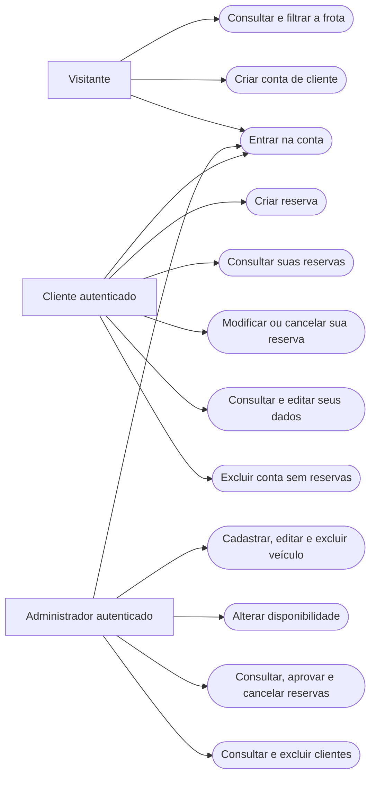
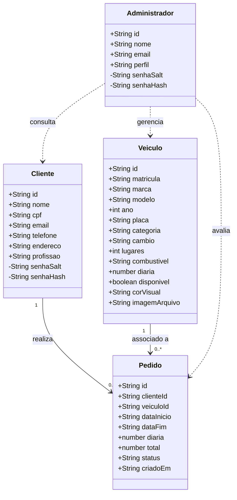
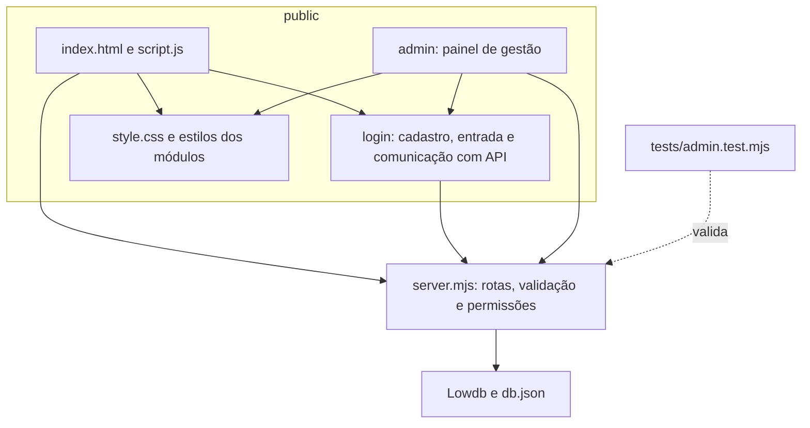
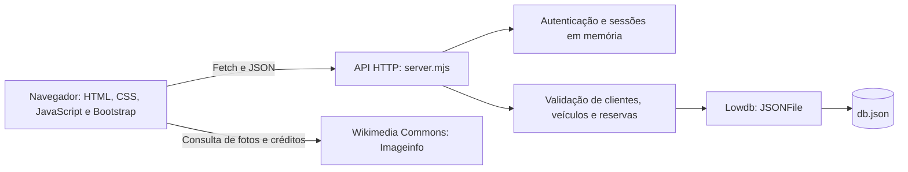

# Modelagem — via — Aluguel de Automóveis

Esta modelagem documenta o protótipo disponível no repositório. Os diagramas usam Mermaid e podem ser visualizados no GitHub ou em um editor compatível.

Os arquivos JavaScript implementam a aplicação com funções e objetos; o diagrama de classes representa os conceitos dos dados, sem pressupor classes JavaScript no código. Empresas, bancos e contratos do enunciado completo ainda não fazem parte da implementação.

## Casos de uso

O desenho representa os atores e os casos de uso com a notação de fluxo disponível no Mermaid.

Não existe caso de uso para criar administradores. As três contas são previamente definidas no banco. A exclusão de clientes e veículos vinculados a pedidos é recusada para preservar o histórico.

## Histórias de usuário

| ID | História | Critério de aceitação principal |
|---|---|---|
| HU01 | Como visitante, quero consultar a frota antes de criar uma conta. | O início apresenta uma linha de carros, filtro de categoria e a opção de expandir/recolher. |
| HU02 | Como visitante, quero criar uma conta para reservar um veículo. | O cadastro valida os dados, a confirmação da senha e a unicidade de CPF e e-mail; cria somente cliente. |
| HU03 | Como cliente, quero continuar a reserva após entrar na conta. | O carro escolhido antes do login permanece selecionado ao retornar. |
| HU04 | Como cliente, quero reservar um carro para um período. | O servidor valida as datas, a disponibilidade e conflitos e calcula o total pela diária. |
| HU05 | Como cliente, quero alterar ou cancelar meu pedido. | Somente o titular pode modificar seu pedido; pedidos cancelados permanecem no histórico. |
| HU06 | Como cliente, quero acompanhar o resultado da análise. | A lista exibe os estados Pendente, Aprovado e Cancelado. |
| HU07 | Como administrador, quero gerenciar a frota. | É possível cadastrar e editar veículos, alterar sua disponibilidade e excluir apenas carros sem pedidos vinculados. |
| HU08 | Como administrador, quero analisar os pedidos de todos os clientes. | O painel permite filtrar por status, aprovar e cancelar reservas; o servidor verifica o perfil. |
| HU09 | Como cliente, quero controlar meus dados cadastrais. | A conta permite edição e recusa exclusão quando houver pedidos associados. |

## Diagrama de classes conceitual

O status do pedido é uma das strings `Pendente`, `Aprovado` ou `Cancelado`. Os vínculos usam `clienteId` e `veiculoId`. Anotações de senhas da massa de demonstração são metadados locais, sem participação no processo de autenticação. Os campos de hash e salt representam as contas autenticáveis; sua ausência nos dois clientes de demonstração é uma pendência da massa atual.

## Diagrama de pacotes — visão lógica

## Diagrama de componentes

## Revisão dos modelos

| Registro | Descrição |
|---|---|
| 03/11/2026 — documentação da versão atual | Modelagem alinhada à separação em `public/`, às contas administrativas predefinidas, à frota de 20 carros e à API Node.js com Lowdb. |

O material original disponível inclui o enunciado e o template de README. Não há versões anteriores dos diagramas na pasta `documents/`; este arquivo registra a modelagem da implementação atual, sem atribuir a ela um histórico anterior.
